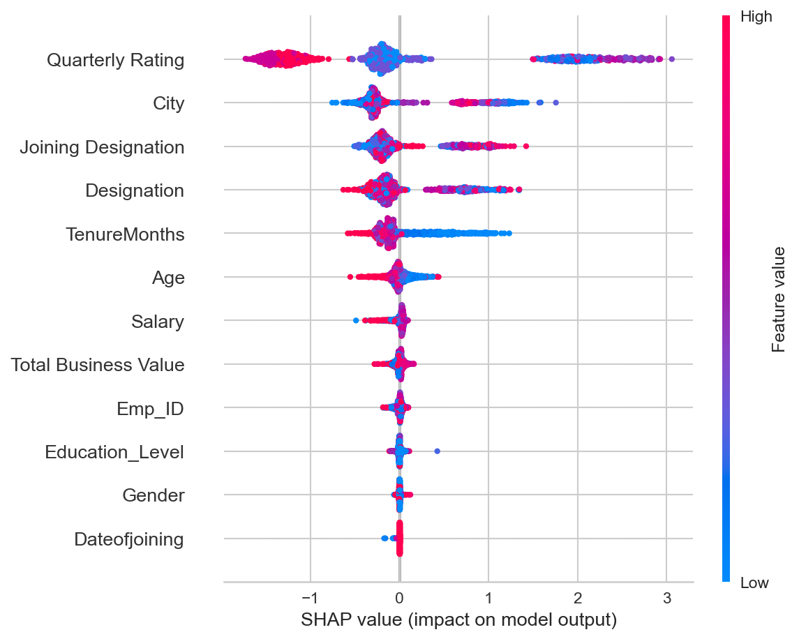
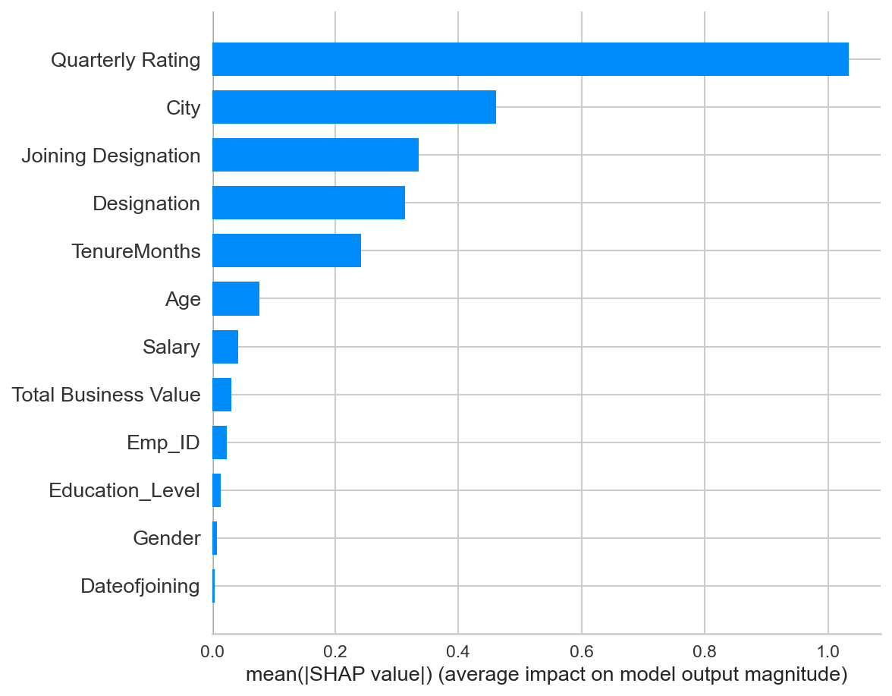

# Predict whether an employee will leave the company using demographics, salary, tenure, education, an...

## Problem Description

Predict Employee Attrition using Demographics, Salary, Tenure

**Source**: direct_input  
**Original URL**: N/A

## Problem Understanding

The system analyzed the problem statement and identified it as a **regression** task with 70% confidence.

**Problem Analysis:**
- **Task Type**: Regression
- **Confidence Level**: 70%
- **Key Features Identified**: features, data

## Dataset

- **Name**: Employee attrition
- **Source**: local
- **URL**: data\datasets\downloaded\sample_employee_data_20000.csv

## ML Solution Approach

The machine learning model solves this problem by:

1. **Problem Formulation**: Treats this as a classification task where the model learns to predict categories/classes based on input features.

2. **Model Selection**: After evaluating multiple algorithms, **Unknown** was selected as the best-performing model.

3. **How It Works**:
   - The model learns patterns from historical data
   - It maps input features to output classes/categories
   - Given new data, it predicts the most likely class
   - The model uses learned decision boundaries to make predictions

4. **Solution Capability**: The model can automatically classify new instances into the appropriate category based on the patterns it learned during training.

## Model Performance

- **Accuracy**: 0.844
- **Precision**: 0.791
- **Recall**: 0.844
- **F1 Score**: 0.777

## Model Interpretability (SHAP)

This project includes SHAP (SHapley Additive exPlanations) outputs for global and local interpretability.

### Top Features by Mean |SHAP|
- **Quarterly Rating**: 1.034380
- **City**: 0.460650
- **Joining Designation**: 0.335517
- **Designation**: 0.313730
- **TenureMonths**: 0.241722
- **Age**: 0.076531
- **Salary**: 0.042561
- **Total Business Value**: 0.031385
- **Emp_ID**: 0.023944
- **Education_Level**: 0.014361

### Generated SHAP Artifacts
- Summary plot: `shap_summary.png`
- Global bar importance: `shap_bar.png`
- Feature importances (JSON): `feature_importance.json`





## Model Details

- **Best Model**: Unknown
- **Framework**: SCIKIT-LEARN
- **Training Date**: 2026-10-30
- **Model File**: `classification_model_20261030_164534.pkl`

## Installation

```bash
pip install -r requirements.txt
```

## Usage

### Training

1. Place your dataset as `data.csv`
2. Update the target column name in `train.py`
3. Run:
```bash
python train.py
```

### Prediction

1. Place new data as `new_data.csv`
2. Run:
```bash
python predict.py
```

Predictions will be saved to `predictions.csv`.

## Limitations

- This is an automated solution and may require manual tuning
- Model performance depends on data quality
- Additional feature engineering may improve results

## License

This project is generated by an automated ML pipeline. Use at your own discretion.

## Generated By

Autonomous ML Automation Pipeline
Generated on: 2026-10-30 16:45:37
